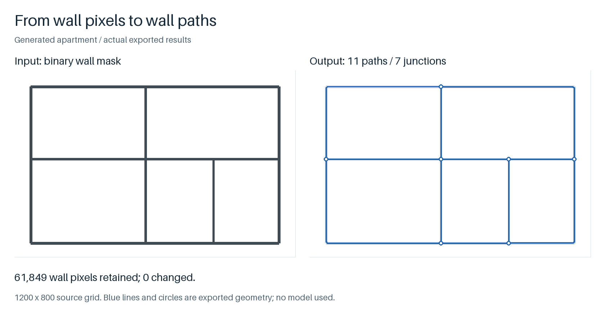

# WallGraph

Extract centerlines and junctions from a binary wall mask, in the original image coordinates.

[中文](README.zh-CN.md) · [v0.2.1](https://github.com/crown-sports/wallgraph/releases/tag/v0.2.1)



Generated example: **11 paths, 7 junctions**, with all 61,849 supplied wall pixels retained. [Run this five-room example](https://github.com/crown-sports/planportals/blob/main/docs/workflow.md).

## Try it

Python 3.10+. The small standalone demo needs no model:

```bash
python -m pip install "git+https://github.com/crown-sports/wallgraph.git@v0.2.1"
wallgraph demo --output runs/demo
```

Keep original inputs in a separate folder. Reusing an output folder replaces its generated result files.

Open `runs/demo/walls.svg`. `walls.json` contains polylines, endpoint node IDs, pixel thickness and scores; `walls.png` contains the wall mask.

For a mask you already have:

```bash
wallgraph vectorize --mask /private/walls.png --output runs/vectorized
```

Use a 2D uint8 PNG containing only 0 and 255; white means wall. Add `--wall-value 0` for black walls. RGB images and probability maps are rejected. Pixels stay unchanged unless you request cleanup with `--close-radius` or `--min-component-area`.

## Use the paths

Coordinates start at the top left: x right, y down, units in pixels. Use the paths to draw selectable walls, follow shared endpoint IDs, or pass the mask and metadata to [PlanRegions](https://github.com/crown-sports/planregions). [PlanMetric](https://github.com/crown-sports/planmetric) can convert lengths once you supply dimensions.

Imported-mask scores describe membership in the supplied mask, not detector confidence. WallGraph does not infer physical scale, door types or a CAD/BIM model.

## Start from a scan

Supply a compatible segmentation model; no public weights are included. [Training and data import](docs/training-guide.md) covers the baseline and file formats.

```bash
python -m pip install "wallgraph[onnx] @ git+https://github.com/crown-sports/wallgraph.git@v0.2.1"
wallgraph detect --image /private/plan.png --model /private/wall.onnx \
  --preprocess rgb --wall-classes 1 --device cpu --output runs/prediction
```

Match preprocessing and class IDs to your model. The adapter accepts float32 NCHW three-channel input in 0–1 and segmentation logits; probability outputs need `--output-kind probabilities`, and dynamic inputs need `--input-size H W`.

[View an actual six-stage ONNX run](examples/simple.png) · [Its inputs and settings](docs/demo-provenance.md). That private model closes some openings and misses a divider. The standalone demo uses ink thresholding, which can also find furniture and text.

The private 30-drawing evaluation found worse wall IoU than raw segmentation and lower downstream region PQ after cleanup. These generated figures are not recognition benchmarks. [Results and limitations](docs/validation.md).

## More

[Implementation notes](docs/product.md) · [API and integration](docs/use-cases.md) · [Methods](docs/methods.md) · [Architecture](docs/architecture.md) · [Reproduction](docs/reproduction.md)

[Contributing](CONTRIBUTING.md) · [Release checks](docs/releasing.md) · [Security](SECURITY.md)

MIT for code and original generated figures. External models and data keep their own licenses. [Provenance](NOTICE.md).
